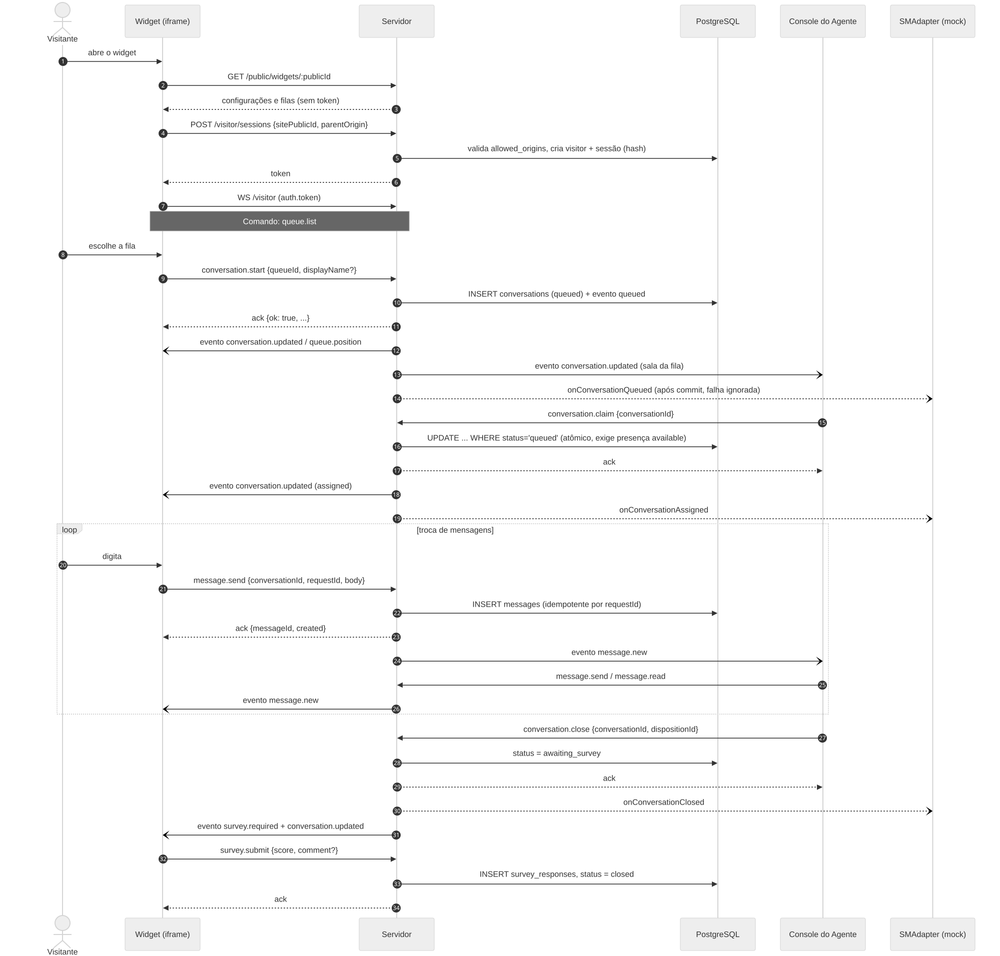
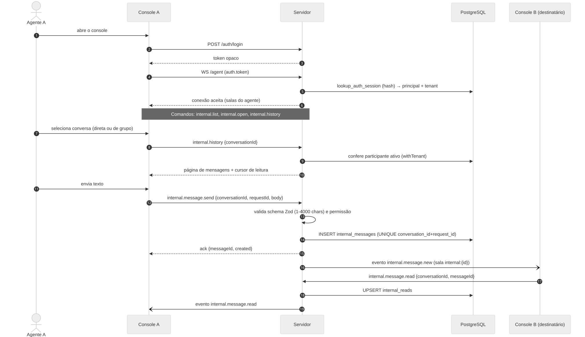
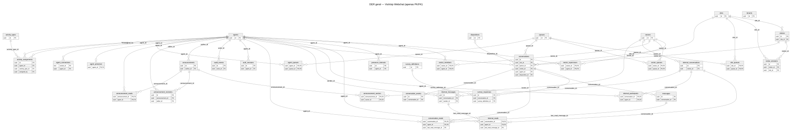

# Diagramas

Fontes editáveis em Mermaid (`*.mmd`); imagens em `rendered/` (SVG e PNG), geradas por `scripts/docs/render-diagrams.sh`. Os ERDs são gerados por `scripts/docs/gen-database.mjs`: não os edite à mão.

| # | Diagrama | Fonte | Imagem |
|---|---|---|---|
| 1 | Contexto do sistema (C4 nível 1) | `context.mmd` |  |
| 2 | Containers (C4 nível 2) | `containers.mmd` |  |
| 3 | Componentes do backend | `backend-components.mmd` |  |
| 4 | Sequência do atendimento externo | `external-chat-sequence.mmd` |  |
| 5 | Sequência do chat interno | `internal-chat-sequence.mmd` |  |
| 6 | DER geral e por domínio | `database-erd*.mmd` |  |
| 7 | Estados: atendimento, presença, atividade | `attendance-states.mmd`, `presence-states.mmd`, `activity-states.mmd` |  |
| 8 | Infraestrutura | `infrastructure.mmd` |  |

Fonte do DER: schema real extraído das migrations `001–007` (ver [database/overview.md](../database/overview.md)). O DER geral é largo por ter 35 tabelas; use os cinco por domínio para leitura.
